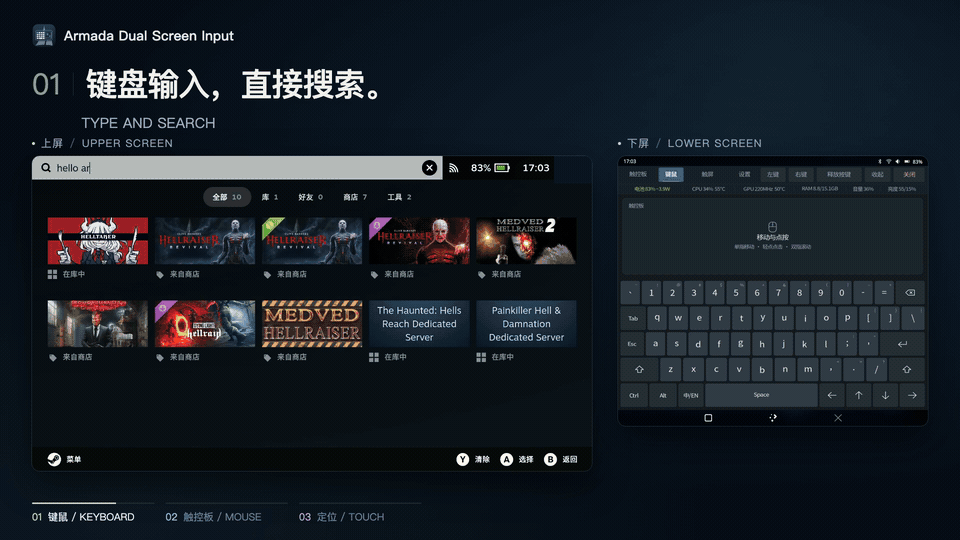

<p align="center">
  <strong>English</strong> · <a href="README.zh-CN.md">简体中文</a>
</p>

<p align="center">
  
</p>

<h1 align="center">Armada Dual Screen Input</h1>

<p align="center">
  <strong>Turn your lower screen into a keyboard, touchpad and touchscreen.</strong><br>
  Virtual keyboard, touchpad and multi-touch for ArmadaOS handhelds.
</p>

<p align="center">
  <a href="https://github.com/sa1utyeggs/armada-dual-screen-input/releases/latest"></a>
  <a href="https://github.com/sa1utyeggs/armada-dual-screen-input/actions/workflows/checks.yml"></a>
  <a href="LICENSE"></a>
</p>

<p align="center">
  <a href="https://github.com/sa1utyeggs/armada-dual-screen-input/releases/latest">Download</a> ·
  <a href="docs/installation.md">Installation</a> ·
  <a href="docs/usage.md">Usage</a> ·
  <a href="docs/compatibility.md">Compatibility</a> ·
  <a href="https://github.com/sa1utyeggs/armada-dual-screen-input/issues">Report an issue</a>
</p>

A standalone Linux application for dual-screen ArmadaOS handhelds. Type, move the pointer and control touch input on the upper screen from the lower screen, without mirroring or continuously streaming the upper display.

> **Currently tested: AYN Thor · ArmadaOS · Steam Game Mode.** Desktop Mode is disabled by default; other devices have not been tested. [System versions and validation scope](docs/compatibility.md)

The interface supports English / Simplified Chinese selection, defaulting to English when no preference exists; input language is independent. The demo below has bilingual captions; recorded app screens use Chinese. [Language settings and validation scope](docs/i18n.md). General settings also provide a [confirmed uninstall action](docs/installation.md#卸载) that keeps personal configuration.

<a id="能做什么"></a>

## Features

| Feature | What it does |
| --- | --- |
| Keyboard and touchpad | Steam-style dark controls for moving, clicking and typing on the lower screen; English US layout and Chinese full-pinyin candidates |
| Two-finger scrolling | One-finger movement, tap to click and two-finger scrolling; pointer speed and scrolling scale can be adjusted independently |
| Two touch modes | Choose Positioning (定位) or Direct touch (直接触屏) from a dropdown; upper-screen rings follow smoothly through an independent visual filter and can coexist with Steam's performance overlay; switching pages or closing the panel releases previous contacts |
| Input settings | Adjust sensitivity, inertia, key repeat, the ring's rendering cap (30 / 60 / 120 FPS / follow screen) and separate idle/pressed colors; saved settings take effect immediately and survive upgrades |
| Steam keyboard integration | Temporarily suppresses Steam's keyboard on the keyboard/touchpad page; restores it when switching pages, collapsing or exiting, with timeout recovery after an unexpected exit |
| In-app updates | Manually check stable releases under Settings → General → Update (设置 → 通用 → 更新), then confirm a verified installation; retry failures or roll back to the previous version |
| Optional Thor touch-driver fix | Settings → Experimental checks compatibility and offers confirmed enable-until-reboot / stock restore, using a separately installed driver component and administrator authentication |

The existing one-line status row also shows signed **net battery power** from cached voltage × current: e.g. `Bat. 96% −5.0W` means discharge; `+` means charging. No extra polling is added. While plugged in, this is battery flow, not total device or charger power. See [telemetry limits](docs/usage.md#battery-power).

### Thor lower-screen touch fix (experimental)

**A driver-level fix helped with stuck touches and missed second-finger taps on the tested Thor.** On 2026-10-22, keeping the app and settings unchanged while switching back to the compatible lower-screen module restored normal operation, confirmed by the user. Changing pointer sensitivity cannot clear a physical touch contact retained by the stock driver.

v0.1.5 adds **Settings → Experimental** for read-only status, kernel compatibility, explicit enable and stock restore. The optional component is installed separately; the normal app bundle includes no kernel module and never enables one automatically. Actions require confirmation and administrator authentication, briefly restart this panel only, and last until reboot. **Only the tested Thor / Armada 20261010 / matching Linux 7.2.6 build is supported; long sessions and suspend/resume need more validation.** [Evidence](docs/thor-ft5452-contact-lifecycle.md) · [Optional setup and rollback](extras/thor-touch-driver/README.md#settings-controls)

<a id="界面预览"></a>

### Interface previews

[](.github/assets/interface-demo.mp4)

[Watch the full demo (46 seconds, 720p MP4)](.github/assets/interface-demo.mp4). The animated preview combines recorded dual-screen use with an illustrated positioning-touch explanation: the index finger moves the pointer, while the middle finger maintains contact until it curls into the palm to release the apple. Actual multi-touch reception depends on the lower-screen hardware, Steam's touch policy and the receiving application. [Multilingual keyboard](docs/multilingual-keyboard.md) · [Touch controls](docs/usage.md)

<a id="快速开始"></a>

## Quick start

Run this as your regular user in an **Armada desktop terminal**:

```bash
curl -fsSL https://raw.githubusercontent.com/sa1utyeggs/armada-dual-screen-input/main/get.sh | bash
```

After installation, open **虚拟键鼠** from the desktop or application menu, then enter Steam Game Mode to use the panel. **Do not use sudo. Installation does not open the app or enable autostart by default.** The online installer installs the current `main` build; use an offline release package or specify an existing tag if you want a fixed stable version.

For offline installation, download both the ARM64 `.tar.gz` package and `SHA256SUMS` from the [latest stable release](https://github.com/sa1utyeggs/armada-dual-screen-input/releases/latest). Verify the checksum, extract the package and run `bash install.sh`. GitHub's automatically generated **Source code** archives are not the offline installer bundle.

For an existing installation, open **设置 → 通用 → 更新 → 检查更新** (Settings → General → Update → Check for updates), then confirm the upgrade. To roll back, run:

```bash
~/.local/bin/armada-dual-screen-input rollback
```

The installer manages only this app's user-directory files, desktop entry and user service. It preserves personal configuration and the existing autostart choice. **Experimental kernel drivers are not included or enabled.** [Installation, upgrades, rollback and removal](docs/installation.md)

<a id="文档导航"></a>

## Documentation

All first-party guides have English and Simplified Chinese editions. Each guide links to its translation. [Full documentation index](docs/README.md) · [中文文档](docs/zh-CN/README.md).

| Looking for | Document |
| --- | --- |
| Installation, dependencies, upgrades or removal | [Installation guide](docs/installation.md) |
| Gestures, Chinese input, settings and updates | [Usage guide](docs/usage.md) · [Multilingual keyboard](docs/multilingual-keyboard.md) |
| Device support and known limitations | [Compatibility](docs/compatibility.md) |
| Development, packaging and releases | [Development guide](docs/development.md) |
| Version changes and original test results | [Changelog](CHANGELOG.md) · [中文更新日志](CHANGELOG.zh-CN.md) · [History](docs/history.md) |
| Stuck physical touch contacts on the Thor lower screen | [Driver investigation and validation](docs/thor-ft5452-contact-lifecycle.md) · [Separate experiment and rollback](extras/thor-touch-driver/README.md) |

Isolated checks and real interaction acceptance are recorded separately for the touch modes. Direct multi-touch gestures, long sessions and suspend/resume still need further validation. Marker rendering was found to cause focus-query timeouts in the *Slay the Spire 2* card viewer; the GL fix passed a short user test. The earlier timeline issue and long-term stability still need observation. Ring/FPS coexistence, touch input and Steam menu round trips passed a short user test on this device and depend on passive decoration-window support in the current Thor Gamescope build. Stuck physical contacts in the Thor's stock FT5452 driver cannot be fixed by changing app sensitivity. [Full limitations and evidence](docs/compatibility.md)

v0.1.3 includes visual ring smoothing installed on the Thor, with the user reporting smoother motion. Eight actual-renderer trials support more even movement and document the additional CPU/GPU cost. [Methods, results and limits](docs/position-touch.md#真实窗口安装用户反馈与八轮资源对比). Color settings also passed temporary-configuration save/reload and real marker-window pixel checks; user acceptance of each palette control is still pending.

<a id="开发与致谢"></a>

## Development and credits

```bash
python3 -B tools/run_tests.py --with-node
python3 -B tools/build_release.py
```

Application code lives in `src/armada_dual_screen_input/`, checks in `tests/`, and installation/packaging tools in `tools/`. Linux GTK checks are skipped on Mac; CI runs the full checks on Linux. Pushing a tag that matches `VERSION` triggers CI to build, verify and publish an ARM64 offline bundle. [Release workflow](docs/development.md#发布)

This project adapts a pinned [Ratatoskr snapshot](vendor/ratatoskr/UPSTREAM) and uses a private gtk-layer-shell runtime. Project code is [MIT licensed](LICENSE); third-party components and the Armada mark retain their own provenance and rights. See [THIRD_PARTY.md](THIRD_PARTY.md). Steam-style controls are independently drawn.
