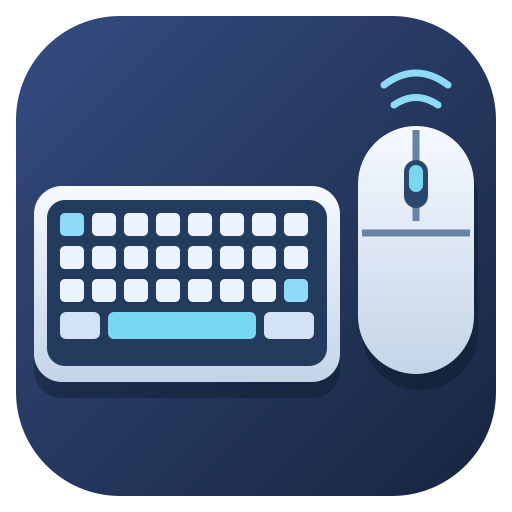
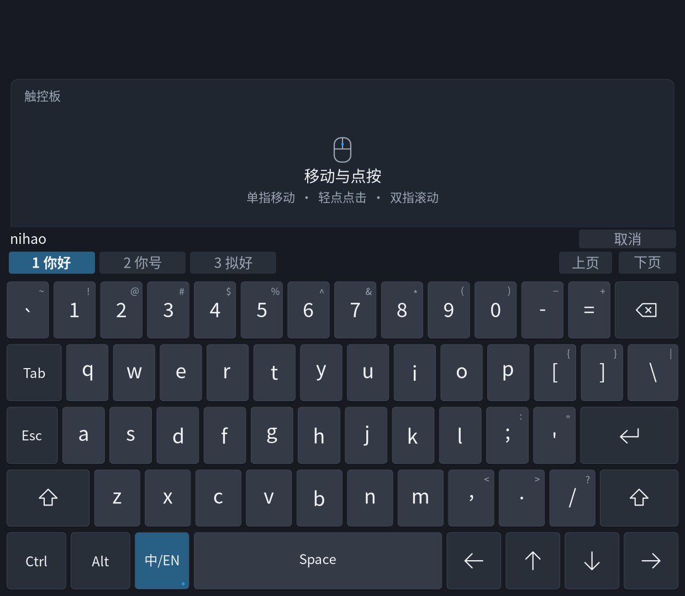
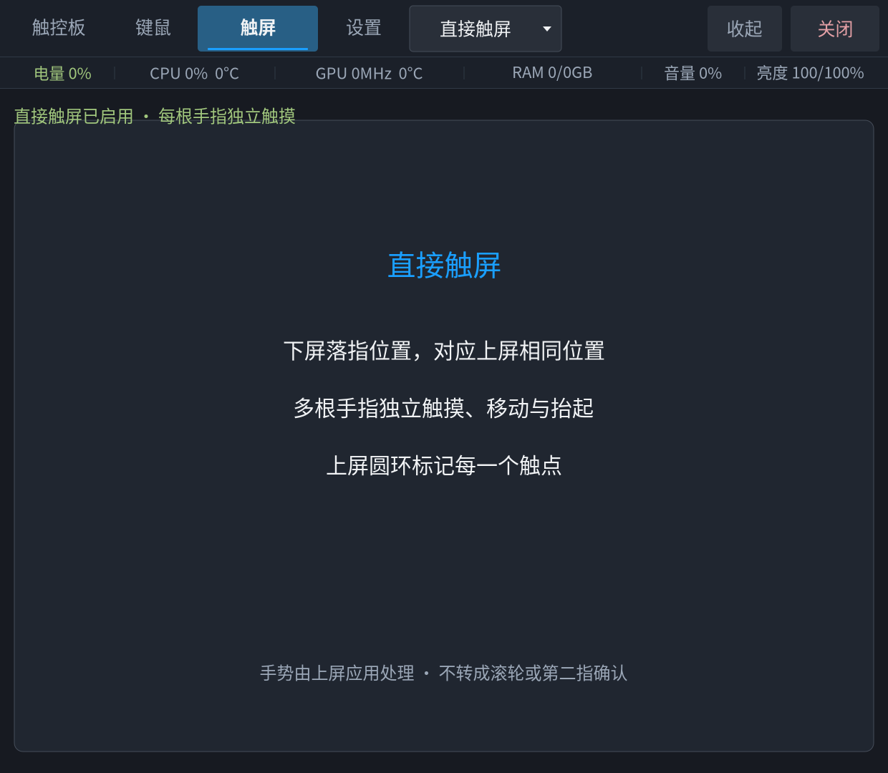

<p align="center">
  <strong>简体中文</strong> · <a href="README.en.md">English</a>
</p>

<p align="center">
  
</p>

<h1 align="center">虚拟键鼠 · Armada Dual Screen Input</h1>

<p align="center">
  <strong>让下屏成为键盘、触控板与触屏。</strong><br>
  Virtual keyboard, touchpad and multi-touch for ArmadaOS handhelds.
</p>

<p align="center">
  <a href="https://github.com/sa1utyeggs/armada-dual-screen-input/releases/latest"></a>
  <a href="https://github.com/sa1utyeggs/armada-dual-screen-input/actions/workflows/checks.yml"></a>
  <a href="LICENSE"></a>
</p>

<p align="center">
  <a href="https://github.com/sa1utyeggs/armada-dual-screen-input/releases/latest">下载正式版</a> ·
  <a href="docs/installation.md">安装指南</a> ·
  <a href="docs/usage.md">使用说明</a> ·
  <a href="docs/compatibility.md">兼容范围</a> ·
  <a href="https://github.com/sa1utyeggs/armada-dual-screen-input/issues">反馈问题</a>
</p>

面向 ArmadaOS 双屏掌机的独立 Linux 应用。在下屏输入、移动指针和触摸上屏，无需镜像或持续传输上屏画面。

> **当前实测：AYN Thor · ArmadaOS · Steam Game Mode。** Desktop Mode 默认关闭，其他机型尚未实测。[系统版本与验证边界](docs/compatibility.md)

## 能做什么

| 功能 | 操作与效果 |
| --- | --- |
| 键盘与触控板 | Steam 风格的深色界面；下屏移动、点按与输入，支持英文 US 和中文全拼候选 |
| 双指滚轮 | 单指移动、轻点点击、双指滚动；移动速度与滚轮倍率分别调整 |
| 触屏双模式 | 下拉选择“定位”或“直接触屏”；圆环仅在上屏标记触点，切页或关闭时释放旧触点 |
| 输入设置 | 调整灵敏度、惯性和长按重复；保存后生效，升级保留个人配置 |
| Steam 键盘联动 | 键鼠页临时抑制原生键盘；切页、收起或退出后恢复，异常退出有超时恢复机制 |
| 应用内更新 | 在“设置 → 更新”手动检查正式版，确认后校验并安装；失败可重试、旧版本可回退 |

### 界面预览

| 中文键盘与触控板 | 直接触屏 |
| :---: | :---: |
| [](.github/assets/keyboard-preview.png) | [](.github/assets/touch-preview.png) |

以上为离屏渲染预览，状态数值为示例；点击图片可查看原图。真实多指识别取决于下屏硬件、Steam 触摸策略及上屏应用。[多语言键盘](docs/multilingual-keyboard.md) · [触屏说明](docs/usage.md)

## 快速开始

在 **Armada 桌面终端**以普通用户运行：

```bash
curl -fsSL https://raw.githubusercontent.com/sa1utyeggs/armada-dual-screen-input/main/get.sh | bash
```

安装后从桌面或应用菜单打开 **虚拟键鼠**，进入 Steam Game Mode 使用。**不要使用 sudo；默认不自动打开，也不开机自启。** 在线入口安装 `main` 当前构建；需要固定正式版本时，使用下面的离线包或指定已有 tag。

离线安装：从 [最新正式版](https://github.com/sa1utyeggs/armada-dual-screen-input/releases/latest) 同时下载 ARM64 `.tar.gz` 和 `SHA256SUMS`，校验、解压后运行 `bash install.sh`。GitHub 自动生成的 **Source code** 不是离线安装包。

已有安装可进入 **设置 → 更新 → 检查更新**，再确认升级。需要回退时运行：

```bash
~/.local/bin/armada-dual-screen-input rollback
```

安装器只管理本应用的用户目录、桌面入口与用户服务，保留个人配置和原自启动选择。**不包含或启用实验内核驱动。** [完整安装、升级、回退与卸载](docs/installation.md)

## 文档导航

| 我想了解 | 文档 |
| --- | --- |
| 安装、依赖、升级或卸载 | [安装指南](docs/installation.md) |
| 手势、中文输入、设置与更新 | [使用说明](docs/usage.md) · [多语言键盘](docs/multilingual-keyboard.md) |
| 设备支持与已知限制 | [兼容范围](docs/compatibility.md) |
| 参与开发与打包发布 | [开发指南](docs/development.md) |
| 查看版本变化与原始测试结论 | [Changelog](CHANGELOG.md) · [历史记录](docs/history.md) |
| 排查 Thor 下屏物理触点残留 | [驱动诊断与验证](docs/thor-ft5452-contact-lifecycle.md) · [独立实验与回退](extras/thor-touch-driver/README.md) |

触屏双模式的隔离检查与真实交互验收分开记录；直接多指、长期使用和休眠恢复仍需进一步验证。《杀戮尖塔2》时间线出现过间歇重连，原因尚未定位。Thor 原厂 FT5452 的物理触点残留不能靠调整应用灵敏度修复；独立驱动实验的短时实测不等于应用已修复驱动。[完整限制与证据](docs/compatibility.md)

## 开发与致谢

```bash
python3 -B tools/run_tests.py --with-node
python3 -B tools/build_release.py
```

应用位于 `src/armada_dual_screen_input/`，检查位于 `tests/`，安装与打包工具位于 `tools/`。Mac 跳过 Linux GTK 检查；CI 在 Linux 执行完整检查。推送与 `VERSION` 对应的 tag 后，CI 构建、校验并发布 ARM64 离线包。[发布流程](docs/development.md#发布)

本项目基于 [Ratatoskr](vendor/ratatoskr/UPSTREAM) 的固定快照适配，使用私有 gtk-layer-shell 运行库。项目代码采用 [MIT](LICENSE)；第三方组件与 Armada 标识保留各自来源及权利，见 [THIRD_PARTY.md](THIRD_PARTY.md)。Steam 风格控件为独立绘制。
