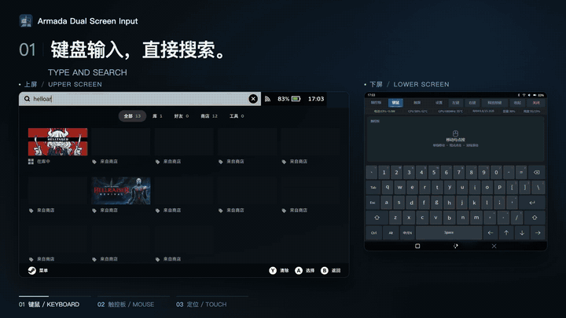
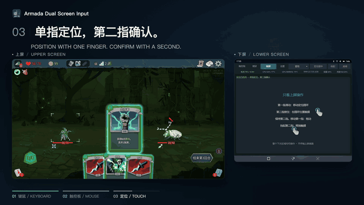

<p align="center">
  <a href="README.md">English</a> · <strong>简体中文</strong>
</p>

<p align="center">
  
</p>

<h1 align="center">虚拟键鼠 · Armada Dual Screen Input</h1>

<p align="center">
  <strong>让下屏成为键盘、触控板与触屏。</strong><br>
  Virtual keyboard, touchpad and multi-touch for ArmadaOS handhelds.
</p>

<p align="center">
  <a href="https://github.com/sa1utyeggs/armada-dual-screen-input/releases/latest"></a>
  <a href="https://github.com/sa1utyeggs/armada-dual-screen-input/actions/workflows/checks.yml"></a>
  <a href="LICENSE"></a>
</p>

<p align="center">
  <a href="https://github.com/sa1utyeggs/armada-dual-screen-input/raw/refs/heads/main/Install-Armada-Dual-Screen-Input.desktop"><strong>下载点击安装器</strong></a> ·
  <a href="https://github.com/sa1utyeggs/armada-dual-screen-input/releases/latest"><strong>离线安装包</strong></a> ·
  <a href="docs/zh-CN/installation.md">安装指南</a> ·
  <a href="docs/zh-CN/usage.md">使用说明</a> ·
  <a href="docs/zh-CN/compatibility.md">兼容范围</a> ·
  <a href="https://github.com/sa1utyeggs/armada-dual-screen-input/issues">反馈问题</a>
</p>

面向 ArmadaOS 双屏掌机的独立 Linux 应用。在下屏输入、移动指针和触摸上屏，无需镜像或持续传输上屏画面。

> **当前实测：AYN Thor · ArmadaOS · Steam Game Mode。** Desktop Mode 默认关闭，其他机型尚未实测。[系统版本与验证边界](docs/zh-CN/compatibility.md)

界面支持中英切换，缺少语言配置时默认英文；与键盘输入语言独立。下方演示配有中英双语字幕，录制的应用画面使用中文。[语言设置与验证边界](docs/zh-CN/i18n.md)。通用设置另提供保留个人配置的[卸载入口](docs/zh-CN/installation.md#卸载)，需要二次确认。

## 界面预览

**键盘与鼠标**



**杀戮尖塔2与手势演示**



第二张动图结合游戏实录与定位触屏原理动画：食指移动指针，中指保持接触，收回掌心表示离开屏幕并松开苹果。真实多指识别取决于下屏硬件、Steam 触摸策略及上屏应用。[多语言键盘](docs/zh-CN/multilingual-keyboard.md) · [触屏说明](docs/zh-CN/usage.md)

[下载完整演示（46 秒，720p MP4）](https://raw.githubusercontent.com/sa1utyeggs/armada-dual-screen-input/main/.github/assets/interface-demo.mp4)。

## 能做什么

| 功能 | 操作与效果 |
| --- | --- |
| 键盘与触控板 | Steam 风格的深色界面；下屏移动、点按与输入，支持英文 US 和中文全拼候选 |
| 双指滚轮 | 单指移动、轻点点击、双指滚动；移动速度与滚轮倍率分别调整 |
| 触屏双模式 | 下拉选择“定位”或“直接触屏”；上屏圆环独立平滑跟随，可与 Steam 性能叠加显示共存；切页或关闭时释放旧触点 |
| 输入设置 | 调整灵敏度、惯性与长按重复；“图标样式”同时展示蓝／橙圆环（默认）、白／绿圆环、手套、像素手和科幻准星五块无名称预览，直接点击所需图案，保存后返回触屏页；指示器帧率上限可选 30 / 60 / 120 / 跟随屏幕，升级保留个人配置 |
| Steam 键盘联动 | 键鼠页临时抑制原生键盘；切页、收起或退出后恢复，异常退出有超时恢复机制 |
| 应用内更新 | 在“设置 → 通用 → 更新”手动检查正式版，确认后校验并安装；失败可重试、旧版本可回退 |
| 可选 Thor 触摸驱动修复 | “设置 → 试验性功能”检查兼容性，确认后可启用到重启或恢复原厂；需要单独安装驱动组件及管理员认证 |

原有单行状态栏同时显示带正负号的**电池净功率**，复用电压×电流缓存。例如 `电池 96% −5.0W` 表示放电，`+` 表示充电；不增加轮询。接电时此值不代表整机或充电器功率。[监控含义与限制](docs/zh-CN/usage.md#battery-power)。

## 快速开始

**在 Armada 桌面模式[获取点击安装器（.desktop）](https://github.com/sa1utyeggs/armada-dual-screen-input/raw/refs/heads/main/Install-Armada-Dual-Screen-Input.desktop)。**

1. 长按或右键安装器链接，选择 **链接另存为**，保存 `Install-Armada-Dual-Screen-Input.desktop`。如果打开后显示文本，按这个文件名另存为即可。
2. 在 **Dolphin 文件管理器**打开文件，按系统提示允许运行，点击 **Install / 安装**。如果 Firefox 添加了 `.download`，先去掉这个额外后缀。窗口展示最新稳定版本，自动下载、校验并安装到当前用户目录。
3. 从桌面或应用菜单打开 **Virtual Keyboard & Mouse / 虚拟键鼠**，进入 Steam Game Mode 使用。

全程无需输入终端命令。窗口默认英文，可选择简体中文。全新安装不自动打开应用、不开机自启；升级保留个人设置和已有自启动选择。[完整步骤与排错](docs/zh-CN/installation.md#click-install)

已有安装可使用 **设置 → 通用 → 更新 → 检查更新**。[离线安装、源码／开发构建、回退与卸载](docs/zh-CN/installation.md)见安装指南。GitHub 自动生成的 **Source code** 不是离线安装包。实验内核驱动仍需单独安装。

## Thor 下屏触摸驱动修复（实验）

**本机实测，驱动修复改善了触点卡住和第二指点按失灵。** 2026-10-22 保持应用与配置不变，仅重新启用兼容的下屏驱动模块后，用户确认操作恢复正常。调整指针灵敏度无法清除原厂驱动残留的物理触点。

v0.1.5 增加 **设置 → 试验性功能**：只读查看状态与内核兼容性，手动确认启用或恢复原厂。驱动组件单独安装；普通应用包不含内核模块，也不会自动启用。操作需要二次确认及管理员认证，只短暂重启本面板，生效至重启。**仅支持已测 Thor / Armada 20261010 / 匹配指纹的 Linux 7.2.6 构建；长期使用与休眠恢复仍需继续验证。** [排查证据](docs/zh-CN/thor-ft5452-contact-lifecycle.md) · [可选组件安装与回退](extras/thor-touch-driver/README.zh-CN.md#settings-controls)

## 文档导航

| 我想了解 | 文档 |
| --- | --- |
| 安装、依赖、升级或卸载 | [安装指南](docs/zh-CN/installation.md) |
| 手势、中文输入、设置与更新 | [使用说明](docs/zh-CN/usage.md) · [多语言键盘](docs/zh-CN/multilingual-keyboard.md) |
| 设备支持与已知限制 | [兼容范围](docs/zh-CN/compatibility.md) |
| 参与开发与打包发布 | [开发指南](docs/zh-CN/development.md) |
| 查看版本变化与原始测试结论 | [Changelog](CHANGELOG.zh-CN.md) · [历史记录](docs/zh-CN/history.md) |
| 排查 Thor 下屏物理触点残留 | [驱动诊断与验证](docs/zh-CN/thor-ft5452-contact-lifecycle.md) · [独立实验与回退](extras/thor-touch-driver/README.zh-CN.md) |

触屏双模式的隔离检查与真实交互验收分开记录；直接多指、长期使用和休眠恢复仍需进一步验证。《杀戮尖塔2》查看牌场景已定位到圆环绘制导致的焦点超时，GL 修复通过短时用户验收；早期时间线问题及长期稳定性仍需观察。圆环与 FPS 共存、触屏操作及菜单往返已通过本机短时验收，依赖当前 Thor Gamescope 的被动装饰窗口支持。Thor 原厂 FT5452 的物理触点残留不能靠调整应用灵敏度修复。[完整限制与证据](docs/zh-CN/compatibility.md)

v0.1.3 包含已在 Thor 安装的圆环视觉平滑，用户反馈更顺畅；八轮真实绘制器测试支持步长更均匀，同时记录了额外 CPU / GPU 成本。[测量方法、数据与边界](docs/zh-CN/position-touch.md#真实窗口安装用户反馈与八轮资源对比)。配色设置另通过临时配置保存 / 重载及真实圆环窗口像素检查，尚未由用户逐项点选验收。

## 开发与致谢

```bash
python3 -B tools/run_tests.py --with-node
python3 -B tools/build_release.py
```

应用位于 `src/armada_dual_screen_input/`，检查位于 `tests/`，安装与打包工具位于 `tools/`。Mac 跳过 Linux GTK 检查；CI 在 Linux 执行完整检查。推送与 `VERSION` 对应的 tag 后，CI 构建、校验并发布 ARM64 离线包。[发布流程](docs/zh-CN/development.md#发布)

本项目基于 [Ratatoskr](vendor/ratatoskr/UPSTREAM) 的固定快照适配，使用私有 gtk-layer-shell 运行库。项目代码采用 [MIT](LICENSE)；第三方组件与 Armada 标识保留各自来源及权利，见 [THIRD_PARTY.md](THIRD_PARTY.zh-CN.md)。Steam 风格控件为独立绘制。

完整导航见[双语文档索引](docs/zh-CN/README.md)。
